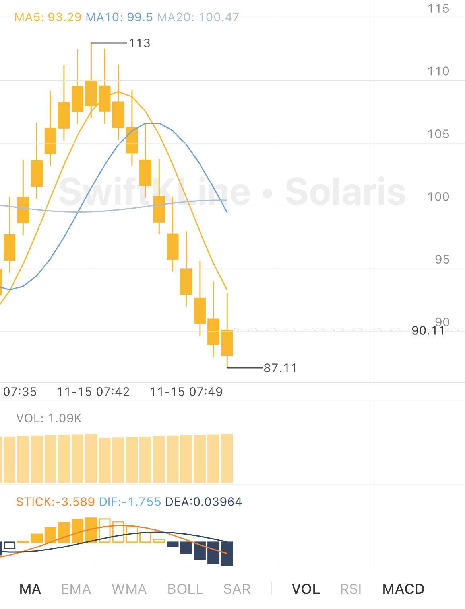

# SwiftKLine

A lightweight, modular candlestick chart library for **iOS and iPadOS**, built with Swift 6, UIKit, and Core Animation, with a SwiftUI adapter.

[](#requirements)
[](#requirements)
[](#installation)
[](LICENSE)

<p align="center">
  
</p>

[Features](#features) · [Installation](#installation) · [Quick Start](#quick-start) · [Documentation](#documentation) · [Contributing](#contributing)

## Features

- Candlestick and time-series charts.
- Pinch to zoom, horizontal scrolling, and crosshair inspection.
- Historical pagination, live candle updates, and optional gap recovery.
- Built-in indicators with configurable periods and styles.
- Custom indicators through calculator and renderer protocols.
- UIKit and SwiftUI integration with application-owned data providers.
- Visible-range drawing, reusable layers, and coalesced live refreshes.
- Zero third-party dependencies.

### Built-in indicators

| Indicator | Description | Placement |
| --- | --- | --- |
| MA | Simple moving average | Main chart |
| EMA | Exponential moving average | Main chart |
| WMA | Weighted moving average | Main chart |
| BOLL | Bollinger bands | Main chart |
| SAR | Parabolic stop and reverse | Main chart |
| VOL | Traded volume | Lower panel |
| RSI | Relative strength index | Lower panel |
| MACD | Moving average convergence/divergence | Lower panel |

## Requirements

| Requirement | Minimum |
| --- | --- |
| iOS | 13.0 |
| iPadOS | 13.0 |
| Swift | 6.0 |
| Xcode | 16.0 |

The example app has a separate deployment target of iOS 18.0.

## Installation

### Xcode

1. Choose **File → Add Package Dependencies…**.
2. Enter [https://github.com/zhwayne/SwiftKLine](https://github.com/zhwayne/SwiftKLine).
3. Select the `SwiftKLine` library product and add it to your app target.

### Swift Package Manager

Add the package to your dependencies:

```swift
.package(
    url: "https://github.com/zhwayne/SwiftKLine.git",
    branch: "main"
)
```

Then add the library product to your target:

```swift
.product(name: "SwiftKLine", package: "SwiftKLine")
```

The examples below use the development API on `main`. Pin a commit revision when you need a fixed dependency.

## Quick Start

### UIKit

Create a chart, add layout constraints, and load data through a `ChartItemProvider`. This example uses the `SnapshotProvider` defined in [Data Providers](#data-providers):

```swift
import UIKit
import SwiftKLine

@MainActor
final class ChartViewController: UIViewController {
    override func viewDidLoad() {
        super.viewDidLoad()

        let chart = ChartView(options: ChartOptions(
            appearance: .theme(.solaris),
            features: []
        ))
        chart.translatesAutoresizingMaskIntoConstraints = false
        view.addSubview(chart)

        NSLayoutConstraint.activate([
            chart.leadingAnchor.constraint(equalTo: view.safeAreaLayoutGuide.leadingAnchor),
            chart.trailingAnchor.constraint(equalTo: view.safeAreaLayoutGuide.trailingAnchor),
            chart.topAnchor.constraint(equalTo: view.safeAreaLayoutGuide.topAnchor)
        ])

        let provider = SnapshotProvider(candles: [
            Candle(timestamp: 1_700_000_000, open: 100, high: 105, low: 98, close: 103, volume: 500),
            Candle(timestamp: 1_700_000_060, open: 103, high: 108, low: 102, close: 106, volume: 620),
            Candle(timestamp: 1_700_000_120, open: 106, high: 107, low: 101, close: 102, volume: 540)
        ])
        chart.loadData(using: provider)
    }
}
```

`ChartView` provides an intrinsic height based on its selected panels. Give it a width and vertical position through your layout.

Use `loadData(using:)` to attach or replace a provider. The chart loads its historical pages and consumes its live stream when enabled. Call `stopDataLoading()` to cancel provider work while retaining the displayed chart.

**Timestamps are candle-open Unix times in seconds.** Keep the timestamp stable when revising a candle. Prices, volume, and traded amount must be finite, with `high >= low`.

### SwiftUI

Use `KLineChart` with a stable source identity and a provider factory. The following example uses the `SnapshotProvider` defined in [Data Providers](#data-providers):

```swift
import SwiftUI
import SwiftKLine

@MainActor
struct MarketChart: View {
    let seriesID: String
    let candles: [Candle]

    var body: some View {
        KLineChart(
            sourceID: seriesID,
            options: ChartOptions(
                appearance: .theme(.solaris),
                features: []
            )
        ) {
            SnapshotProvider(candles: candles)
        }
        .fixedSize(horizontal: false, vertical: true)
    }
}
```

The factory runs when the source first appears or `sourceID` changes. Include the symbol, period, or dataset revision in that identity when those changes should reload data. The adapter stops loading when SwiftUI removes the chart.

Use `content:` to switch presentation and `indicators: $selection` to bind indicator selection. Appearance and plugins are creation-time options; use SwiftUI’s `.id(...)` when replacing them.

## Data Providers

Implement `ChartItemProvider` to connect your own storage or market-data service. A provider can start with immutable snapshots:

```swift
import Foundation
import SwiftKLine

final class SnapshotProvider: ChartItemProvider, Sendable {
    private let candles: [Candle]

    init(candles: [Candle]) {
        self.candles = candles
    }

    func fetchChartItems(forPage page: Int) async throws -> [any ChartItem] {
        page == 0 ? candles : []
    }

    func fetchChartItems(from start: Date, to end: Date) async throws -> [any ChartItem] {
        candles.filter {
            TimeInterval($0.timestamp) >= start.timeIntervalSince1970 &&
            TimeInterval($0.timestamp) <= end.timeIntervalSince1970
        }
    }
}
```

Attach a provider to an existing UIKit chart with `chart.loadData(using: provider)`.

| API | Contract |
| --- | --- |
| `fetchChartItems(forPage:)` | Page `0` contains the newest history. Later pages move backward; an empty page ends pagination. |
| `fetchChartItems(from:to:)` | Returns snapshots for an inclusive interval used during gap recovery. |
| `liveStream()` | Optional `AsyncStream` of complete candle snapshots. The default stream finishes immediately. |
| `candlePeriod` | Optional fixed bucket duration. The default `nil` matches exact candle-open timestamps. |

For live providers, cancel independent producer tasks and close connections in the stream’s `onTermination` handler. Use exact opening timestamps for calendar periods such as months.

Enable provider features through `ChartOptions(features: [.liveUpdates, .gapRecovery])`. Loading errors are reported through `onLoadError`; `stopDataLoading()` cancels the session while retaining displayed data.

The example app includes a [Binance provider](SwiftKLineExample/BinanceDataProvider.swift) built with `URLSession` and `Decodable`. Exchange-specific transport stays in the application.

## Configuration

Choose a theme and initial indicator selection through `ChartOptions`:

```swift
let options = ChartOptions(
    appearance: .theme(.midnight),
    indicators: IndicatorSelectionState(
        mainIndicatorIDs: [.ma, .boll],
        subIndicatorIDs: [.vol, .macd]
    ),
    features: [.liveUpdates, .gapRecovery, .indicatorPersistence]
)

let chart = ChartView(options: options)
```

Use `ChartConfiguration` for custom candle colors, section heights, legend fonts, indicator styles, and calculation periods. Built-in appearance presets include `.midnight` and `.solaris`.

Update presentation and selection without replacing the chart:

```swift
chart.setContentStyle(.timeSeries)

chart.setIndicators(IndicatorSelectionState(
    mainIndicatorIDs: [.ema],
    subIndicatorIDs: [.vol, .rsi]
))

chart.indicatorSelectionChanged = { selection in
    print(selection)
}

chart.resetIndicatorsToDefault()
chart.scrollToLatest()
```

When `.indicatorPersistence` is enabled, saved selections take precedence over the declared initial selection. Omit that feature for an application-controlled initial selection.

## Custom Indicators

Custom indicators combine:

- `IndicatorCalculator`: a `Sendable` calculation with input-aligned output.
- `IndicatorPlugin`: an identity, placement, and factories for calculators and renderers.
- `ChartRenderer`: reusable drawing, legends, and visible value bounds.

For scalar outputs, reuse `LineIndicatorRenderer(series:)`. Register plugins with an independent `PluginRegistry` before creating the chart. Include calculation parameters in each `SeriesKey` and rendering parameters in each renderer’s identity.

The `SwiftKLineCore` library product exposes models, built-in calculators, and `IndicatorEngine` independently of chart rendering. See the [architecture guide](docs/architecture.md) for extension contracts and calculation behavior.

## Example App

Open `SwiftKLineExample.xcodeproj`, select the `SwiftKLineExample` scheme, and run it on an iOS simulator or a supported device.

Add `--demo` to the scheme’s launch arguments to use offline sample data. SwiftUI previews also use offline data. The live example requires access to the exchange endpoints.

## Documentation

| Guide | Contents |
| --- | --- |
| [Architecture](docs/architecture.md) | Module boundaries, plugin contracts, snapshot consistency, and cancellation. |
| [Performance](docs/performance.md) | Reproducible calculation benchmarks, complexity, and measurement limits. |
| [Migration](docs/migration.md) | Module changes, explicit candle periods, and updated integration APIs. |

The detailed guides are currently written in Chinese.

## Development

```sh
# Run the core calculation and data tests.
swift test

# Run the package tests on an installed iOS simulator.
./script/test-ios.sh

# Build the example for the iOS simulator.
./script/build-example.sh

# Run calculation benchmarks in Release mode.
swift run -c release SwiftKLineBenchmark
```

## Contributing

Bug reports, feature discussions, and pull requests are welcome.

For a bug report, include your Xcode version, device or simulator OS, relevant chart configuration, and a small dataset or provider that reproduces the issue.

For code changes, add focused regression coverage where appropriate and run the relevant checks above. Keep source comments in English and document public API behavior.

## License

SwiftKLine is available under the [MIT license](LICENSE).
