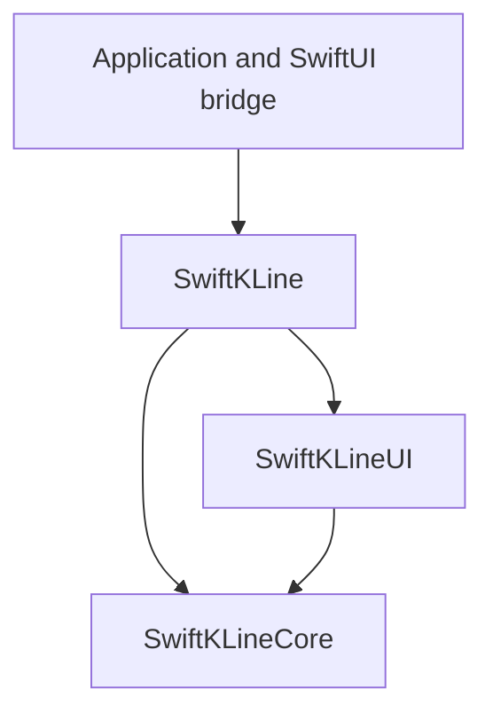
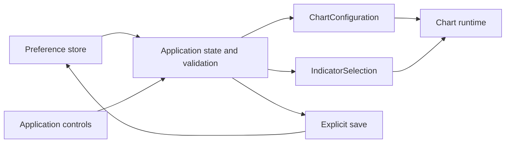
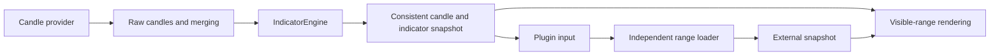

# Architecture and ownership

**English** | [简体中文](zh-CN/architecture.md)

[Documentation](README.md) · [Configuration](configuration.md) · [Plugins](plugins.md)

SwiftKLine separates candle data, indicator calculation, and visible-range drawing. One configuration describes a chart; each chart owns the runtime state needed to realize it.

## Module boundaries

| Module | Responsibility |
|---|---|
| `SwiftKLineCore` | Foundation models, merge rules, calculators, typed outputs, range loaders, and the primary candle-loading session |
| `SwiftKLineUI` | Configuration reconciliation, plugins, panels, layout, UIKit, and Core Animation |
| `SwiftKLine` | Umbrella imports for package consumers |

Only `SwiftKLine` and `SwiftKLineCore` are library products. The umbrella's UI dependencies are conditional on iOS. Core has no UIKit dependency and supports host tests and benchmarks on macOS.

Exchange protocols, authentication, accounts, and execution semantics belong to the application. The library supplies the calculation, loading, and rendering contracts. The [trade-marker example](../SwiftKLineExample/TradeMarkers/TradeMarkerExample.swift) demonstrates that boundary.

## Ownership

| Owner | State |
|---|---|
| Application | Period, indicator choices, preference storage, configuration values, providers, and business models |
| Chart | Primary session, calculation publication, plugin coordinators, and drawing layers |
| Plugin coordinator | Feature-specific resources, independent sessions, subscriptions, and cancellation |
| Application SwiftUI bridge | Forwards values to ChartView, sizes the host, and ends sessions on removal |

A provider factory runs for each chart's new primary session. Sharing a configuration does not share a coordinator. If a factory returns a shared service, that service must isolate subscriptions and cancellation itself.

Plugins are matched by stable ID and concrete type. On removal or replacement, the host revokes the context before cleanup. Resource collections, panel assembly, type erasure, and internal session tokens stay inside the implementation.

## Preferences and chart inputs

`ChartPreferences` and `ChartStateStore` are example application source, absent from the library. `ChartScreenState` is an application-owned observable instance that restores preferences once and persists changed values. `ContentView` only binds to it. `ChartAppearance` contains visual settings; `IndicatorConfiguration` holds independent calculation keys. Available indicators and default choices belong to the application. Restore it, validate its period against application capabilities, then construct `ChartConfiguration`. Bind application controls to application state and send current configuration and `IndicatorSelection` values to the chart. Save snapshots explicitly when desired.

The application filters availability without replacing its stored preference. The chart retains its input and derives recognized, correctly placed, unique built-ins for rendering. It never rewrites the application preference, so temporary availability changes are reversible. Custom plugins remain explicit configuration declarations. Source identity determines when providers restart; indicator-only updates retain the primary session and unchanged plugin coordinators.

This replaces the previous `ChartSelection`/`ChartSelectionController` model. The chart no longer owns persistence, period normalization, a configuration factory, selection callbacks, or asynchronous binding reconciliation. The application may wrap `ChartView` with `UIViewRepresentable`; the library contains no SwiftUI target, import or adapter API. The example's `KLineChart` forwards values, sizes the host and calls `shutdown()` on removal.

## Data publication

The primary loader fetches history, consumes live snapshots, and recovers gaps. `IndicatorEngine` computes against an immutable candle batch. Candles and the indicator outputs calculated from them are published together, avoiding mixed revisions during rendering.

Live ticks arriving during calculation enter the next batch. History and configuration invalidation receive immediate scheduling priority. Source or calculation-semantic changes invalidate results from the old session.

Each plugin has an output namespace. Its renderer reads scoped series through `ChartContext`, so multiple plugins can use the same `SeriesKey` independently.

External range loaders do not join the primary publication barrier. Slow or failed application data does not delay candles and indicators; a completed external snapshot updates its renderer and requests a redraw.

## Concurrency and teardown

| Boundary | Work |
|---|---|
| `MainActor` | Configuration, plugin lifecycle, publication, views, and layers |
| Primary loader actor | History, live consumption, recovery, and request state |
| Each `RangeLoader` actor | Independent cursor, coverage, cache, and cancellation state |
| Structured calculation tasks | Indicator computation over immutable input |

Cross-boundary values are `Sendable`. Providers should cooperate with cancellation and close stream resources on termination. Session checks reject late results from requests that finish after cancellation.

Terminal, idempotent shutdown rejects later updates, cancels sessions and queued drawing, removes notification observers, revokes contexts, dismantles plugin resources, and releases installed layers. Plugin-owned tasks still require explicit cleanup. See [plugin lifecycle](plugins.md#plugin-lifecycle).

## Rendering and interaction

The canvas remains viewport-sized. Total history width affects scrolling without creating a view for each candle. Renderers reuse layers and process visible data.

The main panel supports candlestick and time-series presentation. Time-series presentation hides main-panel plugins whose IDs resolve to built-in indicators and candle high/low annotations, while preserving the latest-price label, guide line, and return-to-latest control. Application `.main` plugins with their own IDs render in both modes. Hiding an indicator does not remove its calculator. Each plugin's `.sub` renderers share one sub-panel.

Scroll, zoom, and data updates redraw visible content. Crosshair updates can target interaction layers and legends. Data, configuration, and explicit plugin requests invalidate the legend cache; time-series paths also track interior candle revisions.

Events are mapped through actual candle intervals. Missing buckets must stay gaps; calendar and session rules are covered in [Time and boundaries](data-providers.md#time-and-boundaries). Cost and measurement guidance is in [Performance](performance.md).
