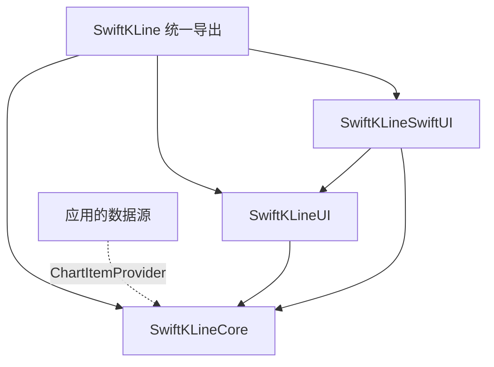

# 架构与扩展约定

## 依赖方向

Core 只依赖 Foundation，没有 UIKit、SwiftUI、网络框架和第三方包。公开值模型、指标标识、计算器、计算引擎和输出快照。内部合并器通过 Swift 的 `package` 访问级别供 UI 使用，不泄漏到应用 API。

UIKit 模块拥有可视化状态。`ChartCoordinator` 管理原始数据与 provider 会话，`ChartItemLoader` actor 管理分页、补数和流；`ChartView` 负责把计算完成的快照提交到布局与渲染器。`IndicatorPipeline` 在主 actor 读取插件和选择，之后把 Sendable 计算器交给 Core 中的结构化任务组执行。

SwiftUI 模块只处理视图桥接。`sourceID` 是数据源生命周期边界，`content` 和指标 Binding 可在同一视图上更新；appearance 和插件是创建时输入。

## 两类刷新

1. **结构刷新**：切换图表类型、指标或数据源。创建 descriptor，按 renderer ID + zIndex 对齐并复用实例，安装/移除变化部分。
2. **数据刷新**：整批历史、补数、实时 tick。计算指标并更新可见区；结构未变化时直接使用已有 descriptor。

renderer 的 ID 必须包括所有影响渲染语义的配置参数。内置标量折线使用完整 `SeriesKey` 数组作为身份；BOLL、MACD、SAR 使用各自序列键，防止不同参数的实例被错误复用。

MA、EMA、WMA 统一使用公开的 `LineIndicatorRenderer`。业务 Double 序列可以直接复用它；复杂输出再实现自己的 renderer。渲染器只遍历 `visibleRange`，图例通过 cache 复用，十字线有单独刷新路径。仅十字线更新可以走快捷路径，数据和布局刷新始终进行完整绘制。

## 数据与指标的快照一致性

原始行情始终由 coordinator 管理。渲染层只发布已完成计算的不可变快照，避免用旧指标解释新数据索引。

- 每次结构变化生成新的 generation，过期计算即使不响应取消也不能提交。
- 每批计算开始时取原始数据快照、当前指标选择、上次输出以及最早修改位置。
- 等待计算期间到来的 tick 更新原始数据并记录下一批最早修改位置，不取消本批工作。
- 计算完成时一起提交蜡烛与指标，增加 `dataRevision`，再安排下一批。
- 实时刷新最多保留一个等待任务，200 ms 等待从任务创建时计时，后续 tick 不重置截止时间。因此持续输入不会无限推迟绘制。
- 任务只保有一次有限计算的视图引用；后续刷新重新使用 weak capture，释放视图不依赖行情流结束。

`dataRevision` 参与分时图 path cache，能够识别中间蜡烛变化，即使可见范围、末根价格和 y 轴边界不变。

## 指标扩展

`IndicatorCalculator` 必须遵守 Sendable，输出值也必须 Sendable。`AnyIndicatorCalculator` 使用受约束的类型擦除，存储中的 existential 是 `any Sendable`；产品不使用 unchecked Sendable 存储。错误类型的读取返回 nil。

`calculate(for:)` 是唯一必需的计算方法。`update(for:values:from:)` 有全量默认实现；选择实现增量时，调用者保证索引之前的输入没有变化。改变计算器参数或算法含义时必须从 0 重新计算。

Core 引擎不保存全局缓存，也不管理 UI 选择。任务组并发运行不同序列，按声明顺序合并结果；重复键始终由最后一个声明覆盖。错误长度的插件输出在引擎边界截断或补 nil，与输入对齐。取消后不提交部分输出；同步自定义计算器应主动检查 `Task.isCancelled`，否则会延迟其所属任务组的结束。

EMA 沿用历史约定：周期内逐步平均，达到周期后使用 alpha = 2 / (period + 1)。RSI 采用 Wilder 平滑，MACD 使用该 EMA 约定，BAR 为两倍差值。变更算法约定需要独立的版本与迁移说明。

## 数据源与生命周期

同一个 loader 的 `stop()` 是终态，不能再次 start；新数据源创建新的 loader。这使“停止请求先于启动任务被 actor 处理”也不会重新创建订阅。

分页任务的存在即表示正在加载，避免多个滚动回调在任务开始前重复启动同页。空首页同样发送完成事件，释放首次加载期间暂存的 tick。首次请求失败保留重试能力。

恢复请求使用独立 token。进入后台、停止或发起新恢复会使旧 token 失效；取消无效的 provider 即使继续返回，也不能改写新请求的状态或重启实时流。先补数后重连，避免过期 HTTP 数据覆盖并发 live 快照。

实时任务在等待流时不强持有 loader。provider 自己负责让生产端任务响应流的 `onTermination`，清理 WebSocket 等资源；仅取消消费任务不会自动关闭独立生产任务。

`ChartView` 释放后在 MainActor 取消 loader、停止监视器、移除 observer。通知 token 存放于 MainActor 对象中，无需 nonisolated(unsafe)；价格标记通知只作用于拥有该控件的图表，避免多个图表互相滚动。

## 合并与内存

默认以精确开盘时间戳为身份。只有明确提供固定 `candlePeriod` 时，才使用向下取整的时间桶；支持负时间戳，避免时间戳乘法溢出。月线等日历周期应直接使用交易所开盘时间。

有序批次线性合并；无序批次先按桶排序，重复桶采用原输入最后一个快照。实时尾部修改/追加使用常量次比较，中间修改二分定位。Array 插入、值快照以及指标输出的 copy-on-write 仍可能产生 O(n) 内存移动。

框架不自动截断历史。需要限制内存的应用可管理自己的滚动数据窗口，然后通过 `setItems` 替换。流的有界缓冲策略也由 provider 决定；示例缓冲为 512 条快照，若业务要求所有事件都必须保留，应自行聚合、持久化或实现背压。
