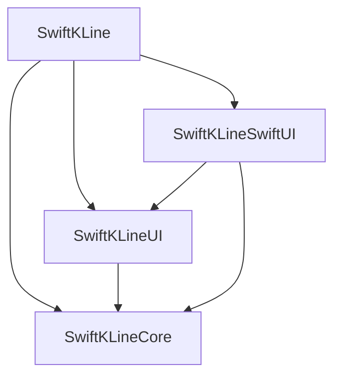

# 架构与所有权

[English](../architecture.md) | **简体中文**

[文档索引](README.md) · [配置](configuration.md) · [插件](plugins.md)

SwiftKLine 将 K 线数据、指标计算和可见范围绘制分开。一份配置描述图表，每个图表拥有实现这份配置所需的运行时状态。

## 模块边界

| 模块 | 职责 |
|---|---|
| `SwiftKLineCore` | Foundation 模型、合并规则、计算器、类型化输出与范围加载器 |
| `SwiftKLineUI` | 配置协调、插件、面板、布局、UIKit 与 Core Animation |
| `SwiftKLineSwiftUI` | 配置转发、绑定同步、尺寸协商与清理 |
| `SwiftKLine` | 为包使用方提供统一导入入口 |

只有 `SwiftKLine` 和 `SwiftKLineCore` 是库产品。统一入口的 UI 依赖仅在 iOS 条件下引入。Core 不依赖 UIKit，可在 macOS 上运行宿主机测试和基准测试。

交易所协议、认证、账户和成交语义属于应用。库提供计算、加载和渲染契约；[成交标记示例](../../SwiftKLineExample/TradeMarkers/TradeMarkerExample.swift) 展示了这一边界。

## 状态归属

| 所有者 | 状态 |
|---|---|
| 应用 | 配置值、provider 实现、业务模型与账户身份 |
| 图表 | 主会话、计算发布、插件协调器与绘制图层 |
| 插件协调器 | 功能专属资源、独立会话、订阅与取消状态 |
| SwiftUI 适配器 | 绑定同步，不创建第二套数据运行时 |

每个图表启动新的主会话时都会调用 provider 工厂。共享配置不等于共享协调器。如果工厂返回共享服务，该服务必须自行隔离订阅与取消行为。

插件通过稳定 ID 与具体类型匹配。移除或替换时，宿主先撤销上下文再清理。资源集合、面板组装、类型擦除和内部会话令牌保留在实现内部。

## 数据发布

主加载器负责历史请求、实时快照和缺口恢复。`IndicatorEngine` 基于不可变 K 线批次计算。K 线与对应指标输出一起发布，避免渲染混用不同修订的数据。

计算期间到达的实时消息进入下一批。历史和配置失效请求具有即时调度优先级。数据源或计算语义变化会使旧会话结果失效。

每个插件拥有独立输出命名空间。渲染器通过限定作用域的 `ChartContext` 读取序列，多个插件可以独立使用相同 `SeriesKey`。

外部范围加载器不加入主数据发布屏障。业务数据缓慢或失败不会延迟 K 线和指标；外部快照完成后更新自身渲染器并请求重绘。

## 并发与清理

| 边界 | 工作 |
|---|---|
| `MainActor` | 配置、插件生命周期、发布、视图与图层 |
| 主加载器 actor | 历史、实时消费、恢复和请求状态 |
| 每个 `RangeLoader` actor | 独立游标、覆盖、缓存和取消状态 |
| 结构化计算任务 | 基于不可变输入进行指标计算 |

跨边界值遵循 `Sendable`。Provider 应配合取消，并在流终止时关闭资源。会话检查拒绝取消后才完成的迟到结果。

销毁时取消会话、撤销上下文、清理插件资源并释放已安装图层。插件拥有的任务仍须显式清理，详见[插件生命周期](plugins.md#插件生命周期)。

## 渲染与交互

画布保持视口大小。历史总宽度影响滚动，不会为每根 K 线创建视图。渲染器复用图层并处理可见数据。

主图支持蜡烛图和分时图。分时图隐藏 ID 可解析为内置指标的主图插件和 K 线高低点标注，同时保留最新价格标签、价格指示线和返回最新位置控件。使用自有 ID 的业务 `.main` 插件在两种模式中均渲染。隐藏指标不会移除其计算器。每个插件的 `.sub` 渲染器共用一个副图。

滚动、缩放和数据更新重绘可见内容。十字光标可仅更新交互图层与图例。数据、配置和显式插件请求使图例缓存失效；分时路径还跟踪中间 K 线的修订。

事件通过真实 K 线区间映射，缺失时间桶必须保留为缺口。日历与交易时段规则见[时间与边界](data-providers.md#时间与边界)，成本与测量方法见[性能](performance.md)。
